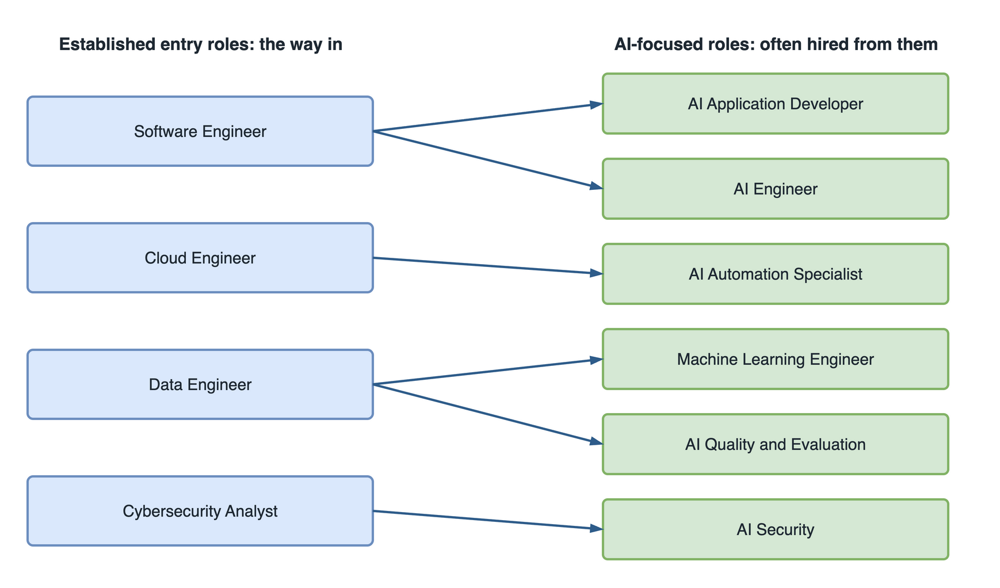
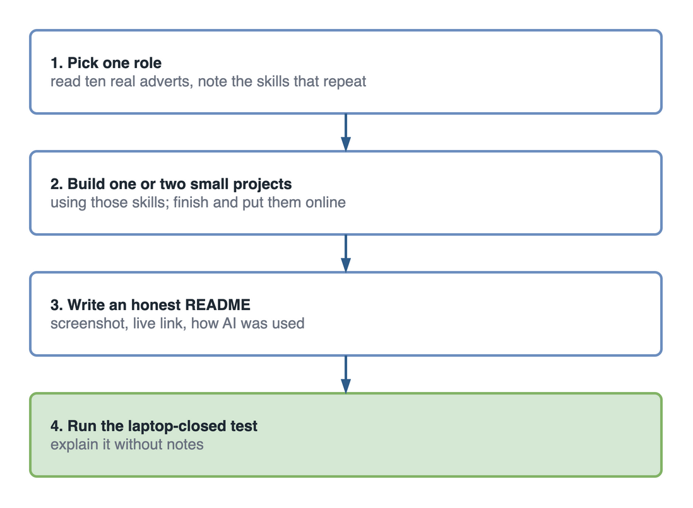

The IT jobs of the future include established roles that AI is changing, such as software, cloud, data and security, and emerging roles built around AI, such as AI engineer and AI evaluation specialist. Many emerging roles hire from established ones, so for most newcomers the way in is an established role first, with AI skills on top.

[Part 1](/blog/future-of-it-industry-ai-newcomers) described the work, [part 2](/blog/it-students-change-how-you-learn-ai-era) how to learn and [part 3](/blog/it-skills-newcomers-ai-era) which skills. This part maps the roles and how to aim at one.

## Forty applications for one job title

Picture a final-year student who decides, sensibly enough, that AI is where the future is. They search for "AI Engineer", find forty openings, and apply to all of them.

Three months later they have two replies, both rejections. Reading the adverts again, they notice what they skimmed the first time. Most asked for "two or more years of software engineering experience" or "experience building production data pipelines". The AI work was real. It sat on top of an established role the student had not aimed at.

The next round of applications goes to graduate software engineer and cloud engineer roles, with an AI project on the CV to show where they want to grow. The replies start coming.

## Established and emerging IT roles

**Established roles** have existed for years and are changing because of AI. **Emerging roles** are newer, their titles vary between companies, and they often sit on top of an established role.

<figure>
  
  <figcaption>For most newcomers, the road to an AI-focused role runs through an established entry role.</figcaption>
</figure>

| Role | Type | What the work involves | Key skills |
| --- | --- | --- | --- |
| Software Engineer | Established, changing | Designing, building, reviewing and maintaining software, with AI assistants in the loop | Programming, APIs, databases, testing, AI-assisted development |
| Cybersecurity Analyst | Established, growing | Monitoring, investigating and responding to threats, including AI-enabled attacks | Networking, security, critical thinking |
| Cloud Engineer | Established | Building and running cloud infrastructure and platforms | Cloud, security, automation |
| DevSecOps Engineer | Established | Building pipelines that test, scan and deploy securely | CI/CD, security, cloud |
| Data Engineer | Established | Building the pipelines and models that make data reliable | Databases, data pipelines, cloud |
| Machine Learning Engineer | Established | Building, deploying and monitoring models in production | Data, statistics, AI evaluation |
| Solutions Architect | Established, senior | Designing whole systems across teams, usually after several years of building | Architecture, cloud, communication |
| AI Application Developer | Emerging | Building apps and features on top of existing models | APIs, context engineering, AI-assisted development |
| AI Engineer | Emerging | Building retrieval systems, agents and evaluation into production software | Agents, evaluation, backend development |
| AI Automation Specialist | Emerging | Automating business processes with AI and workflow tools | Agents, APIs, communication |
| AI Quality and Evaluation Specialist | Emerging | Testing AI features for accuracy, safety and regressions | Evaluation, testing, security |
| AI Security Specialist | Emerging | Protecting AI features from prompt injection, data leaks and misuse | Security, AI literacy, testing |
| AI Product Specialist | Emerging | Deciding which AI features to build and how to measure them | AI literacy, UX, communication |

No role here comes with a guaranteed job or salary, and anyone who promises one is selling something. What the data does show is direction: the [US Bureau of Labor Statistics](https://www.bls.gov/ooh/computer-and-information-technology/software-developers.htm) projects software developer, QA and tester jobs to grow 10% from 2025 to 2035, even as [entry-level hiring has tightened](https://hai.stanford.edu/ai-index/2026-ai-index-report/economy).

## What every IT role now expects

Whatever role you aim at, the same five expectations show up.

- **Fundamentals under pressure.** Reasoning about data, networks and code without autocomplete.
- **Judgement with AI.** Checking its output rather than trusting it.
- **Security instinct.** Noticing the open access rule, the hardcoded key, the missing validation.
- **Finished work.** Something a stranger can use, not a folder of tutorials.
- **Communication.** Explaining a technical choice to a non-technical person in two minutes.

## How to show you are ready for a role

Experience is the usual proof, and newcomers do not have it yet. Finished work you can explain is the replacement.

<figure>
  
  <figcaption>Pick, build, document, explain. Each step makes the next one easier to believe.</figcaption>
</figure>

1. **Pick one role** from the table and read ten real adverts for it. Note the skills that repeat.
2. **Build one or two small projects** that use those skills. Finish them, deploy them, and add tests that run on every push with [GitHub Actions](https://docs.github.com/en/actions).
3. **Write an honest [README](https://docs.github.com/en/repositories/managing-your-repositorys-settings-and-features/customizing-your-repository/about-readmes)**: a screenshot, a live link, setup steps, and a short note on where AI helped and what you changed after reviewing it.
4. **Run the laptop-closed test.** Close the laptop and, on a blank sheet, draw the architecture, walk through one request, and describe one failure you fixed and one trade-off you made.

## Questions students ask about choosing a role

**How do I get experience when every entry-level job asks for experience?** Build it outside a job. Internships, open-source contributions, hackathons and small projects for real users (a student club, a local charity, a family business) all count. Each gives you finished work and a real person who used it, which is what "experience" means at entry level.

**Is "prompt engineer" a real job?** Rarely as a title on its own. The skill is real and is now expected inside other roles: developers, analysts and AI engineers all need it. Aim for one of the roles in the table and bring that skill with you.

**Do I need a master's degree?** Usually not for software, cloud, security or AI application roles. Research-heavy machine learning roles are the exception. Check ten real adverts for the role you want before deciding.

**Should I take any IT job, or wait for the right one?** Take a good first job in an established role rather than waiting for a perfect AI title. Most emerging roles hire from established ones, so a year in software, support, testing, cloud or data is a route in, not a detour.

**Can I switch fields later?** Yes. IT careers move sideways all the time: support to cloud, testing to automation, development to security. The fundamentals carry over, which is one more reason to build them well.

## Before you apply: a checklist

- [ ] I have picked one role and read at least ten real adverts for it.
- [ ] I have one or two finished projects that use the skills those adverts repeat.
- [ ] Each project is online, has tests, and has a README with a screenshot.
- [ ] Each README says honestly where AI helped and what I checked.
- [ ] My CV describes what each project does and what I decided, not just the tools.
- [ ] I can explain every project with the laptop closed.
- [ ] I have applied for internships, not only full-time roles.

## Key takeaways

- Future IT jobs are established roles that AI is changing, plus emerging AI roles that often hire from them.
- For most newcomers, the route to an AI role runs through software, cloud, data or security first.
- Every role now expects fundamentals, judgement with AI, security instinct, finished work and clear communication.
- Replace missing experience with one or two finished, deployed projects you can explain without AI.

## The second round of applications

Back to the student with forty rejected applications. The second round is smaller: fifteen graduate roles in software and cloud, each CV pointing to the same deployed project, with a README that says where AI helped and what was fixed after review.

The first interview opens on that project. The interviewer asks who can access the data, what happens when a request fails, and which part the AI wrote. The student answers all three without opening the laptop. Six months into the job, their team starts its first AI feature, and they are the one who already built one.

The future IT professional will not be defined by how much code they can type, but by how well they understand problems, use technology, work with AI, protect systems and build solutions that create value.

Your degree gives you a starting point. Your skills create opportunities. Your curiosity keeps you relevant. Your ability to adapt shapes your future.

## Sources

- US Bureau of Labor Statistics, [Occupational Outlook Handbook: Software Developers, Quality Assurance Analysts, and Testers](https://www.bls.gov/ooh/computer-and-information-technology/software-developers.htm), updated 27 August 2026.
- Stanford HAI, [AI Index Report 2026: Economy](https://hai.stanford.edu/ai-index/2026-ai-index-report/economy), 2026.
