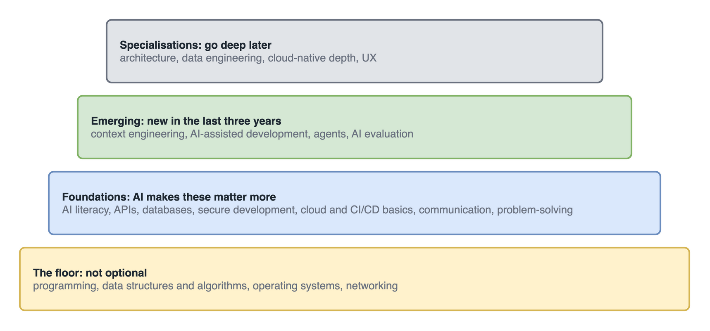
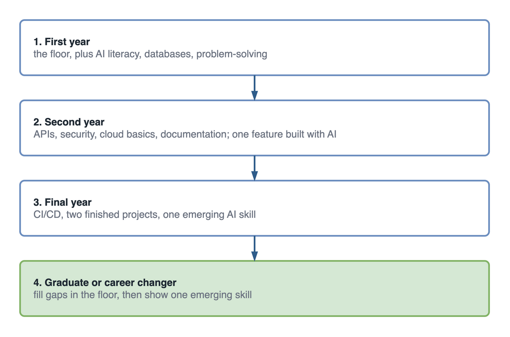

New AI skills sit on top of the old IT foundations, not instead of them. If you are new to IT, learn the floor first (programming, data structures, operating systems and networking), then the foundations (databases, APIs, security, cloud basics and communication), then add emerging AI skills such as context engineering, agents and AI evaluation. Specialise last.

[Part 1](/blog/future-of-it-industry-ai-newcomers) described what IT work looks like now and [part 2](/blog/it-students-change-how-you-learn-ai-era) how to learn for it. This part is the list of what to learn, and in what order.

## Two job adverts, five years apart

Imagine two adverts for the same graduate developer role at the same company, one from five years ago and one from this year. They are illustrative, but put together from the kind of wording you will see on any job board.

The older one is short. It asks for a degree, one or two named languages, a framework, "knowledge of SQL" and "good communication skills". Mostly tools.

The newer one still asks for the degree, the language and SQL. Then it adds lines the old one never had. "Experience using AI coding assistants, and reviewing their output." "Awareness of secure development practices." "Able to explain technical decisions to non-technical colleagues." "Comfortable writing tests and working with CI pipelines."

Nothing was removed. What was added is judgement: checking, securing, testing, explaining. That is the pattern behind every skill in this article.

## How do IT skills stack up in the AI era?

Think of IT skills as four layers. Each layer stands on the one below it.

<figure>
  
  <figcaption>Skip the floor and the AI skills on top have nothing to stand on.</figcaption>
</figure>

- **The floor** is not optional: programming, data structures and algorithms, operating systems and networking. It is how you tell when AI output is wrong.
- **Foundations** are what every IT role now expects, and AI makes them matter more.
- **Emerging skills** barely appeared in job descriptions three years ago. Few newcomers have them. That is why they stand out.
- **Specialisations** are where you go deep later.

The [WEF Future of Jobs Report 2025](https://www.weforum.org/publications/the-future-of-jobs-report-2025/) lists AI and big data, networks and cybersecurity, and technological literacy among the fastest-growing skills, with analytical thinking still the most sought-after core skill. That list maps almost exactly onto the foundations and emerging layers.

## The 15 skills, with a first step for each

| # | Skill | Layer | A good first step |
| --- | --- | --- | --- |
| 1 | AI literacy and generative AI | Foundation | Explain tokens, context windows and hallucination to a friend in plain words |
| 2 | API integration and backend development | Foundation | Build a REST API with authentication and one external integration |
| 3 | Database design and management | Foundation | Design a schema for a real app and explain every index you add |
| 4 | Cybersecurity and secure development | Foundation | Read the [OWASP Top 10](https://owasp.org/www-project-top-ten/), then find two of them in your own old code |
| 5 | Cloud computing basics | Foundation | Deploy one app on a free tier and write down every setting you changed |
| 6 | DevOps, CI/CD and automation basics | Foundation | Add a [GitHub Actions](https://docs.github.com/en/actions) pipeline that runs your tests on every push |
| 7 | Communication and technical documentation | Foundation | Rewrite one README so a new student can run the project in ten minutes |
| 8 | Critical thinking and problem-solving | Foundation | Solve one problem a week by hand before asking AI, then compare |
| 9 | Prompt and context engineering | Emerging | Write an instructions file for your repo and compare output with and without it |
| 10 | AI-assisted software development | Emerging | Build one feature with an assistant, then review its diff as if a classmate wrote it |
| 11 | AI agents and agentic workflows | Emerging | Build an agent that calls one real API and asks before it changes anything |
| 12 | AI evaluation and testing | Emerging | Write 30 test questions with expected answers for an AI feature and score it |
| 13 | Software architecture and system design | Specialisation | Draw the architecture of an app you use daily |
| 14 | Data engineering and analytics | Specialisation | Build a small pipeline from a public dataset to a dashboard |
| 15 | Human-centred design and UX | Specialisation | Watch three people use your app without helping, and note every hesitation |

Cloud and DevOps appear twice in spirit: everyone needs the basics, and going deep on cloud-native platforms or pipelines becomes a specialisation of its own.

## Which IT skills are emerging because of AI?

Four, and they are the newest and least understood, so each gets a few lines.

**Context engineering.** What a model can see matters more than how cleverly you word the request. Giving it the right files, your project's rules and examples of good output is the skill. In a repository that means instruction files such as `AGENTS.md`; the [AGENTS.md playbook](/blog/agents-md-complete-playbook) and the [guide to GitHub Copilot custom instructions](/blog/github-copilot-custom-instructions) show what goes in them.

**AI-assisted development.** Using a coding assistant such as [GitHub Copilot](https://docs.github.com/en/copilot) to plan, write, test and review, with you approving every change. The skill is the approving: reading the diff as carefully as you would read a classmate's.

**AI agents.** An agent calls tools and takes steps on its own. It can also call the wrong tool, loop, or act on bad input. The skill employers want is not "has used an agent". It is building one with limits, logging and a human approval step where the action matters.

**AI evaluation.** A normal function returns the same answer every time. An AI feature does not. Being able to say "this summariser is right on 27 of 30 test documents, and here are the three it gets wrong" is rare in a newcomer, and it stands out.

## Where to start, by year

<figure>
  
  <figcaption>A skill a term is enough, as long as each one is finished before the next.</figcaption>
</figure>

- **First year:** the floor, plus AI literacy, databases and problem-solving. Use AI only to review your own attempts.
- **Second year:** APIs, security, cloud basics and documentation. Build one feature with an assistant and review every line of it.
- **Final year:** CI/CD, and two finished, deployed projects. Add one of context engineering, agents or evaluation, whichever fits those projects.
- **Recent graduate or career changer:** fill the gaps in the floor first, honestly, then show one emerging skill in one finished project.

Leave specialisations until you have finished and deployed at least one real project, because choosing between architecture, data engineering, cloud-native platforms and design is far easier once you have felt which part of a real project you enjoyed and which part you kept putting off. That project will tell you which one you enjoy far better than a course description will.

## Questions students ask about what to learn

**Which programming language should I learn first?** The one your course uses. If you are choosing for yourself, pick Python. It is readable, and it is used for scripting, data and AI. Add JavaScript or TypeScript when you build for the web, and Java or C# if your target employers use them. Concepts carry over. The first language matters far less than learning one properly.

**Do I need maths for AI?** It depends on the job. Building and tuning models, as a machine learning engineer does, needs linear algebra, probability, statistics and some calculus. Building applications on top of existing models needs much less, although basic statistics helps when you measure how often an AI feature is right.

**Should I learn AI first, or web development first?** Web or app development, in most cases. AI features live inside applications, and you cannot add a useful AI feature to an app you cannot build. Once you can build and deploy a small app, adding an AI feature to it is the natural next step.

**Is prompt engineering worth learning?** As a skill, yes. Learn it in its fuller form, context engineering. As a job title on its own, it is rare and fading; employers expect it as part of a developer's or analyst's toolkit.

**Are certifications worth it?** Yes, with a condition. They help most in cloud and security, where employers recognise them. They help most when a project sits beside them that uses what the certificate covered. A certificate on its own shows you studied; the project shows you can do it.

## Your skills checklist

Tick a line only when you could show someone the proof: a project, a test, a write-up.

- [ ] I can write a program from a blank file without AI.
- [ ] I can design a small database and explain every index.
- [ ] I can build an API that checks who is calling it.
- [ ] I can name the OWASP Top 10 risks and have found one in my own code.
- [ ] I have deployed something to a cloud free tier.
- [ ] I have a pipeline that runs my tests on every push.
- [ ] I have written an instructions file for an AI assistant and seen the difference it makes.
- [ ] I have measured an AI feature against test cases, not just tried it a few times.

## Key takeaways

- AI skills sit on top of the old foundations. The floor (programming, data structures, operating systems, networking) is not optional.
- The newer job adverts add judgement to the fundamentals: reviewing AI output, security, testing and explaining.
- The four emerging skills are context engineering, AI-assisted development, agents with limits, and AI evaluation.
- Learn in order: floor, foundations, one emerging skill, then a specialisation chosen from experience.

## Back to the two adverts

Read the newer advert again and notice what it does not ask for. It does not ask for ten frameworks or a list of AI tools. It asks whether you can build, check, secure and explain.

A newcomer who has the floor, most of the foundations and one emerging skill they can show in a finished project fits that advert. Not because they collected every skill on this list, but because they built them in an order that holds.

## Sources

- World Economic Forum, [The Future of Jobs Report 2025](https://www.weforum.org/publications/the-future-of-jobs-report-2025/), 7 January 2025.
- OWASP, [Top 10](https://owasp.org/www-project-top-ten/).
