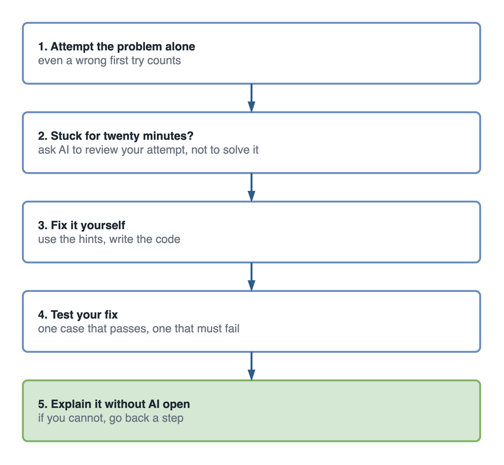

IT students in the AI era need to change how they learn, not just which tools they use. Memorising syntax, watching tutorials end to end and copying code made sense when producing code was the hard part. AI now produces it in seconds. What still has to come from you is judgement, and judgement only grows when you build, test, break and explain your own work.

[Part 1](/blog/future-of-it-industry-ai-newcomers) described what IT work looks like now. This part is a practical guide to learning for it: what to drop from the old way, what to keep, and a weekly routine you can start on Monday.

## Forty hours of tutorials and a blank editor

It is the Sunday before your data structures exam. You have watched about forty hours of tutorials this semester, at 1.5x speed, and every one of them made sense. Linked lists, hash maps, binary search trees. You nodded through all of it.

At 9 p.m. you open a past paper. Question 3 asks you to reverse a linked list in place.

You open the editor. You type the class name. Then nothing.

Your hand drifts to the shortcut that opens the coding assistant, and you stop, because the exam hall will not have one.

You know what a linked list is. You could draw one. What you cannot do is start from an empty file and reason your way to working code, because in forty hours you never had to. The person in the video always knew the next line. During the semester, whenever you got stuck on an assignment, the assistant always knew it too.

That is not a failure of intelligence. It is simply what a learning method built on watching and accepting produces.

## Why the old way of learning IT stopped working

The traditional way of learning assumed that writing code was the scarce skill. You memorised syntax, followed worked examples, and practised until you could reproduce them. As [part 1](/blog/future-of-it-industry-ai-newcomers) showed, that assumption no longer holds: agents now start more than 40% of GitHub pull requests, and professionals spend their time checking what the agents wrote.

One study has a lesson aimed squarely at students. In [METR's 2025 trial](https://metr.org/blog/2025-07-10-early-2025-ai-experienced-os-dev-study/), experienced developers took 19% longer with early-2025 AI tools while believing they had been 20% faster. Feeling faster and being faster are different measurements. AI help can feel like learning while very little learning happens. The exam-night student felt prepared for weeks.

## What should IT students change about the way they learn?

Change the goal of studying from producing an answer to understanding why the answer is right. In practice that means eight specific shifts.

<figure>

![Eight changes in how IT students learn, shown as old way on the left and AI-era way on the right: memorise syntax becomes understand concepts; watch tutorials end to end becomes build after the first third; finish assignments to the rubric becomes solve a real problem; master one language becomes learn concepts that transfer; ask AI for the answer becomes attempt first, then ask AI to review; copy code that works becomes review, test and break it; collect certificates becomes finish real things; study alone becomes learn with people and in public.](./images/old-way-vs-ai-era-learning.png)

  <figcaption>Eight shifts. Each one moves the work from producing an answer to understanding it.</figcaption>
</figure>

Each one comes with a small first step you can take this week. None takes more than an evening.

### 1. From memorising syntax to understanding concepts

AI recalls syntax instantly and never forgets a bracket. What it cannot give you is the understanding to tell whether its output is right.

Ask a coding assistant for a function that looks up a student's grades by ID, and a typical first answer looks like this:

```python
# A common AI first draft: it works with normal input
def get_results(conn, student_id):
    query = f"SELECT module, grade FROM results WHERE student_id = '{student_id}'"
    return conn.execute(query).fetchall()
```

There is no syntax error. Type a real student ID and you get the right grades. Type `' OR '1'='1` instead, and you get every student's grades, because the input became part of the SQL. That is SQL injection, one of the oldest attacks on the web. The safe version passes the ID as a parameter, the way the [Python `sqlite3` documentation](https://docs.python.org/3/library/sqlite3.html) recommends, so the database never treats it as code:

```python
def get_results(conn, student_id):
    query = "SELECT module, grade FROM results WHERE student_id = ?"
    return conn.execute(query, (student_id,)).fetchall()
```

Spotting the difference has nothing to do with memorised syntax. It takes an understanding of how a database reads a query and where untrusted input comes from.

**This week:** pick one topic from your course and write, in three sentences without notes, what problem it solves and what goes wrong without it.

### 2. From watching tutorials to building after the first third

Watching feels like learning because the code always works on screen. The person in the video already made every mistake before recording.

**This week:** stop your next tutorial a third of the way in, close it, and build the rest yourself. Go back to the video only when you are stuck for twenty minutes, and only for the part you are stuck on.

### 3. From assignments to real problems

Assignments have clear specifications, clean input and a rubric. Real problems have none of those.

**This week:** find one small problem around you (a club's sign-up sheet, a family shop's stock list, your own timetable) and write down what a solution would need to do before writing any code.

### 4. From one language to transferable concepts

Languages and frameworks change every few years. State, concurrency, HTTP, SQL, authentication and caching do not.

**This week:** take something you built in one language and rebuild the core of it in another. The parts that feel familiar are the concepts. The parts that feel strange are the syntax, and AI can help with those.

### 5. From asking AI for the answer to using AI as a tutor

Asking AI to solve the problem skips the learning. Asking it to examine your attempt speeds the learning up. The order matters more than the tool.

<figure>



  <figcaption>Attempt first. AI reviews your thinking; it does not replace it.</figcaption>
</figure>

Prompts that keep you doing the reasoning:

```text
Here is my solution to reversing a linked list. Do not rewrite it.
Tell me which inputs would break it and why.

Ask me five questions about this function, one at a time, and tell me
after each answer whether I understood it correctly.

Here is my login function. List every input that could make it
misbehave, and explain why, without fixing it for me.
```

**This week:** for every exercise, write your own attempt first, even a wrong one, before opening the assistant, whether that is [GitHub Copilot](https://docs.github.com/en/copilot) or a chat tool.

### 6. From copying code to reviewing, testing and breaking it

Treat AI output like work from a fast classmate: usually useful, sometimes confidently wrong. You would not hand in a classmate's code without reading it.

**This week:** take one piece of AI-generated code, write two tests for it (one that should pass, one that should fail), and try to break it with input it does not expect.

### 7. From collecting certificates to finishing real things

A certificate shows you studied a topic. A small, finished project that people can use shows you can apply it. Certificates are still worth having; they are worth much more with something you built beside them.

**This week:** finish one small thing you abandoned, even if you have to cut half its features, and put it online.

### 8. From studying alone to learning with people and in public

Explaining something to another person is the fastest way to find out whether you understand it.

**This week:** explain one concept to a classmate, or write a 300-word post about a bug you fixed. If you cannot explain it simply, you have found what to study next.

## The weekly loop: learn, experiment, build, test, break, fix, deploy, explain

The eight shifts come together in one routine. Take one concept each week through eight steps. Most students do the first three. The last five are where the learning sticks.

<figure>


  <figcaption>One concept a week, all eight steps. The explain step shows whether the understanding is yours.</figcaption>
</figure>

Here is the loop applied to one concept, safe database queries, using the grade lookup from shift 1.

**Learn (Monday).** Read the OWASP page on [SQL injection](https://owasp.org/www-community/attacks/SQL_Injection). Write down in one sentence why a parameterised query is safe and a formatted string is not.

**Experiment (Tuesday).** Ask an AI assistant to write a grade lookup function. Check whether its first answer builds the query from a string. Ask it why, then ask it for the safe version and compare the two.

**Build (Wednesday).** Build a tiny results lookup of your own, in whichever language your course uses, with a small database of made-up students.

**Test (Thursday).** Write one test that should pass and one that should fail. A test suite where everything passes on the first run has usually tested nothing.

```python
def test_real_id_returns_that_students_grades(conn):
    assert get_results(conn, "S1001") == [("Databases", "A")]

def test_injection_returns_nothing(conn):
    assert get_results(conn, "' OR '1'='1") == []
```

**Break (Friday).** Try every strange input you can think of: an empty ID, a very long one, quotes, a semicolon, text in another language. If nothing breaks, you have not tried hard enough.

**Fix (Saturday).** Fix what broke, and add a test so it cannot quietly break again.

**Deploy (Saturday).** Put it online, even on a free tier, or at least push it to GitHub with the tests running automatically through [GitHub Actions](https://docs.github.com/en/actions). Code that only runs on your laptop has not met the real world yet.

**Explain (Sunday).** Write 300 words, or record two minutes, answering "why does the parameter stop the attack". Then ask yourself a harder question: even with safe queries, should any logged-in student be able to look up any other student's grades? That is authorisation, a different problem, and noticing it is the skill.

That is one week. Do fifty of them. You will be a different graduate.

### The same loop in other IT disciplines

The steps stay the same; only the concept changes.

| Discipline | A week's concept | What "break" looks like |
| --- | --- | --- |
| Software engineering | Input validation | Send empty, huge and malformed input to your own API |
| Cybersecurity | Password storage | Try to recover passwords from your own test database, then switch to proper hashing |
| Data science | Joins and aggregation | Feed your report duplicate and missing rows, and see if the totals still hold |
| Networking | DNS | Misconfigure a record in a lab setup and trace what fails |
| Cloud computing | Identity and access | Remove one permission and see which part of the app stops working |

Whatever the subject, keep the break and explain steps. They are where the learning is.

## What to keep from the traditional way of learning

Changing how you learn does not mean throwing out what your course teaches. Some of the old way matters more now, not less.

- **The fundamentals.** Programming, data structures and algorithms, databases, operating systems and networking are what you use to judge whether AI output is right. Skip them and the new skills have nothing to stand on.
- **Lectures.** They give structure and explain why things work. They cannot keep pace with tooling that changes every few months, so official documentation and your own projects fill that gap.
- **Solving problems by hand.** Working through a problem with no help is exactly the muscle the exam-night student never built. Do it first, then compare with AI.
- **Exams.** They are a fair check on recall. Study for them, then build one small thing with each topic so it stays.

The newer skills are worth adding as soon as the fundamentals hold: AI literacy (what a model is, what a token is, why it hallucinates), giving AI the right context through instruction files such as [AGENTS.md](/blog/agents-md-complete-playbook), and checking AI output with tests. They belong on top of the fundamentals, not instead of them.

## Ten learning habits to stop, and what to do instead

| Stop | Start instead |
| --- | --- |
| Learning only to pass the exam | Building one small thing with each exam topic |
| Copying code you cannot explain | Rewriting it in your own words, or not using it |
| Depending only on lectures | Reading the official documentation for each topic |
| Watching a whole course before building anything | Building after the first third |
| Asking AI for the answer first | Attempting first, then asking AI to review |
| Assuming AI output is correct | Testing it and trying to break it |
| Avoiding hard topics like concurrency and security | Taking one hard topic a month through the weekly loop |
| Ignoring security in your own projects | Checking every commit for passwords and keys before you push |
| Starting projects you never finish | Scoping down until you can finish in four weeks |
| Keeping your learning private | Explaining one thing a week to a classmate or in a short post |

The security row is worth taking seriously early: a key committed to a public repository can be found and abused within hours, and the [blast radius of a hardcoded key](/blog/hardcoded-key-blast-radius) shows how far it spreads.

## A 30-day plan to change how you learn

Thirty days is enough to feel the difference. The goals are small. That is deliberate.

| Week | Focus | Done when |
| --- | --- | --- |
| 1 | Attempt before asking | Every exercise this week started with your own attempt, and you used AI only to review it |
| 2 | Build instead of watch | You stopped one tutorial a third of the way through and built the rest yourself |
| 3 | Run the full loop once | One concept went through all eight steps, including break and explain |
| 4 | Explain in public | You explained one concept to a classmate and wrote one short post about what you learned |

On day 30, close the laptop. On a blank sheet, explain the concept from week 3: what it is, what you built, what broke and how you fixed it. If you can do that without help, the change has started.

## Questions students ask about learning with AI

**Should I still learn to code if AI can write code?** Yes. You cannot check, fix or secure code you could not have written yourself, and every IT role now involves checking AI output. What you can stop doing is memorising syntax and library function names. Look those up.

**Is using ChatGPT or Copilot for assignments cheating?** It depends on your course, so read the rules for each module. Some allow AI with a declaration, some ban it for assessed work, and exams almost always ban it. A [March 2026 survey of software engineering students](https://arxiv.org/abs/2603.17060) found that misuse happened mostly in programming assignments under time pressure and unclear guidance, not because students wanted to cheat. Where AI is allowed, say how you used it. Where it is not, do not use it. Either way, never hand in code you cannot explain.

**What should I still memorise?** Concepts, not syntax. Know how the main data structures behave, roughly how fast common operations are, how a request travels across a network and how a database finds a row. Those are what let you spot a wrong answer quickly. Function names and flags you can always look up.

**How long until I am ready for a job?** There is no fixed number, and anyone who promises "job-ready in 12 weeks" is selling something. A useful test: can you build a small application from a blank file, put it online, and explain every part of it without AI? Students who run the weekly loop consistently through their course usually get there before they graduate.

**I feel I am behind. Where do I restart?** Pick one concept from your course that you only half understand. Run it through the weekly loop this week. Then the next one. Catching up happens one concept at a time, not by watching faster.

## Your learning checklist

Print this, or pin it above your desk. Tick each line once it has become a habit, not once you have done it once.

- [ ] I attempt every exercise before opening an AI assistant.
- [ ] I stop tutorials early and build the rest myself.
- [ ] I can explain every line of code I hand in.
- [ ] I write at least one test that should fail.
- [ ] I try to break my own work before anyone else does.
- [ ] I put finished work online, even when it is small.
- [ ] I explain one concept a week to someone else.
- [ ] I still solve some problems entirely by hand.

## Key takeaways

- The old way of learning assumed writing code was the hard part. Now judgement is, so practise judgement.
- Make eight shifts: concepts over syntax, building over watching, real problems over rubrics, transferable concepts over one language, AI as tutor, reviewing over copying, finished work over certificates, and learning in public.
- Run one concept a week through learn, experiment, build, test, break, fix, deploy and explain.
- Keep the fundamentals, lectures, hand-solving and exams. New AI skills sit on top of them.
- Attempt first, then use AI to review your attempt. Never hand in code you cannot explain.

## Twelve weeks later

Back to the student with the linked list. Suppose that Sunday night goes badly, and on Monday they change one thing at a time. Every exercise starts with their own attempt. Tutorials stop at the first third. One concept a week: lists, then hash maps, then trees. Each one built from a blank file, tested, broken with nasty inputs, fixed, pushed to a public repository and explained in a short post.

Twelve weeks later, in the next exam, a question asks for a function to detect a cycle in a linked list. It is not a question they have practised. They start anyway: draw the list, try two pointers moving at different speeds, check the empty case, check a list of one. It takes eleven minutes.

They still use AI every day. They just use it after they have had a go, to find out what they missed. The editor is not blank any more, because they have started from blank fifty times.

Your degree gives you a starting point. The way you learn decides what you do with it.

## Sources

- METR, [Measuring the Impact of Early-2025 AI on Experienced Open-Source Developer Productivity](https://metr.org/blog/2025-07-10-early-2025-ai-experienced-os-dev-study/), 10 July 2025. METR published [newer data on late-2025 tools](https://metr.org/blog/2026-02-24-uplift-update/) in February 2026.
- OWASP, [SQL Injection](https://owasp.org/www-community/attacks/SQL_Injection).
- Python, [sqlite3 documentation](https://docs.python.org/3/library/sqlite3.html).
